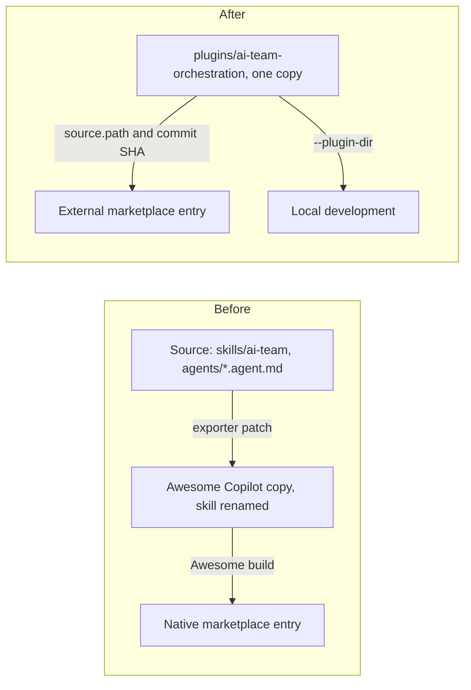

# 0001: Distribute the plugin as one Agent Plugins 1.0 package

- Status: Accepted
- Date: 2026-11-22
- Decided by: Denis (approved plan: "use the installed layout, keep one copy, and rename the source skill to ai-team-orchestration")
- Review: see the pull request `## Review` section
- Links: #18; content alignment in #16

## Context

- This repository was the canonical source. An exporter, `eng/sync-awesome-copilot.mjs`, copied the agents and the skill into an Awesome Copilot checkout. The Awesome Copilot build then served a native plugin from that copy.
- The source skill was `ai-team`. The exporter renamed it to `ai-team-orchestration`. Thus the source and the installed plugin had two copies with different skill names.
- The root `plugin.json` used the legacy `agents` and `skills` fields and had no `$schema`. The public Awesome Copilot gate for external plugins rejects this manifest. Evidence: the [spec compliance gate](https://github.com/github/awesome-copilot/blob/f10fdb8b2660ce85c98f220b2f1ca24653768a5c/.github/scripts/external-plugins/external-plugin-quality-gates.mjs#L193-L315) and the [Agent Plugins 1.0 schema](https://github.com/github/awesome-copilot/blob/f10fdb8b2660ce85c98f220b2f1ca24653768a5c/.github/scripts/lib/agent-plugin-schema.mjs#L5-L29).
- Awesome Copilot also lists external plugins. An external entry points to a public repository, an optional `source.path` and an immutable commit. See the [external plugin contract](https://github.com/github/awesome-copilot/blob/f10fdb8b2660ce85c98f220b2f1ca24653768a5c/CONTRIBUTING.md#L213-L346).
- Denis wants to maintain the plugin in this repository. Later, a separate approved change can replace the native Awesome Copilot entry with an external entry.

## Options considered

1. Keep the legacy layout and the exporter. The root manifest fails the public gate, and the two copies keep different skill names.
2. Generate a distribution copy, for example `distribution/ai-team-orchestration`, from the source. This passes the gates. But it keeps two copies and adds a generator. Denis rejected this option.
3. Convert the repository to the Agent Plugins 1.0 layout of the installed plugin, with one copy. Two locations were possible for the plugin root:
   - The repository root. An install copies the complete plugin root. A test install of the legacy root copied `AGENTS.md`, `CONTRIBUTING.md`, `eng/`, `.github/` and `package.json` into the installed plugin.
   - The folder `plugins/ai-team-orchestration`. The installed payload then contains only plugin files. `plugins/<name>` is the most frequent `source.path` in the [pinned external catalog](https://github.com/github/awesome-copilot/blob/f10fdb8b2660ce85c98f220b2f1ca24653768a5c/plugins/external.json). It is also the path of the native plugin in Awesome Copilot.

## Decision

We chose option 3 with the folder `plugins/ai-team-orchestration`:

- Keep one copy of the plugin in `plugins/ai-team-orchestration/`. This folder is the plugin root and the installed payload.
- Use the layout of the installed plugin: `plugin.json`, `README.md`, `com.github.copilot/agents/<id>.md` and `skills/ai-team-orchestration/`.
- Use only Agent Plugins 1.0 fields in `plugin.json`, with its `$schema`. Discovery uses the standard `skills/` folder and the Copilot `com.github.copilot/` namespace.
- Rename the skill from `ai-team` to `ai-team-orchestration`. The skill name now equals the installed name.
- Remove the Awesome Copilot exporter, its test, its configuration and its npm scripts.
- Release the layout change as version 2.0.1. The agent and skill content does not change.

This diagram shows how the plugin reached users before and after this decision.

## Consequences

- Positive: one copy and one skill name remain. Users get the same files that the current native install contains.
- Positive: the plugin root passes the pinned spec compliance and `vally lint` gates. An external entry can point to `plugins/ai-team-orchestration` at a commit SHA.
- Negative: a user who invoked the source skill as `ai-team` must use `ai-team-orchestration`.
- Negative: an install from the repository root no longer finds a plugin. Install routes must point to the plugin root.
- Negative: the native Awesome Copilot entry stays at version 2.0.0. No tool updates it from this repository now.
- Follow-up: replace the native entry with an external entry. This needs Denis's separate approval.

## Revisit when

- Awesome Copilot does not accept an external entry for this plugin.
- A client that Denis uses cannot install a plugin from a repository folder.
- A new major version of Agent Plugins changes the package layout.
